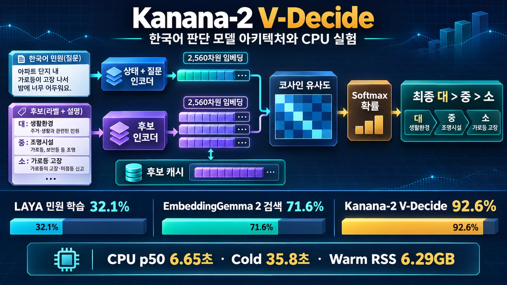
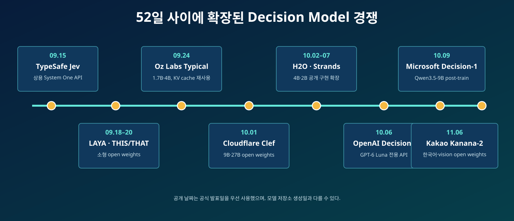
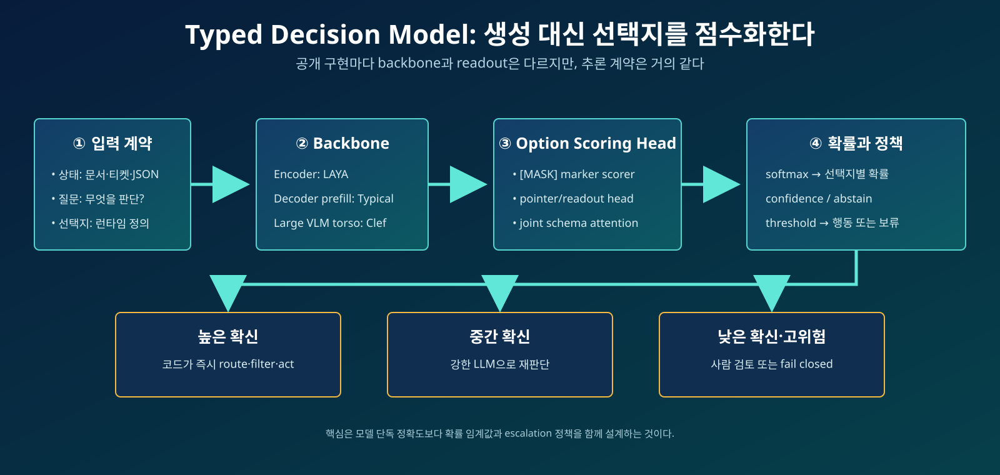

# Kanana2VDecide는 어떻게 답을 고를까? 한국어 성능과 계층 예측 직접 검증

> **최초 조사:** 2026년 10월 12일 · **Kanana 실험 보강:** 2026년 11월 8일
> **한 줄 정의:** Kanana-2 V-Decide는 답변 문장을 생성하지 않고, 입력과 선택지 설명을 각각 벡터로 만든 뒤 가장 적합한 선택지의 확률을 반환하는 Kakao의 3.67B 멀티모달 decision model이다.

2026년 11월 6일 Kakao가 [Kanana-2-v-decide-3b-2611](https://huggingface.co/kakaocorp/kanana-2-v-decide-3b-2611)을 오픈소스로 공개했다. 이 모델은 일반적인 생성형 LLM처럼 설명이나 답변을 쓰지 않는다. 대신 프로그램이 전달한 `choice`, `noul`, `score` 질문을 읽고 각 후보의 확률을 계산한다. text와 JSON, 대화 기록, 최대 10개 image를 받을 수 있고 후보 설명은 추론 시점에 바꿀 수 있다.

이 글의 질문은 세 가지다. **Kanana는 내부에서 어떤 구조로 선택지를 판단하는가? 기존 LAYA·KoBERT·EmbeddingGemma와 무엇이 다른가? 같은 한국어 민원 81건을 넣었을 때 실제로 얼마나 잘하는가?** 공식 모델 카드와 공개 구현을 읽고, Docker CPU 환경에서 동일 평가 자료를 실행해 확인했다.

Jev와 Microsoft Decision-1을 포함한 시장 타임라인은 배경으로만 다룬다. 글의 중심은 Kanana의 모델 구성, query/candidate 데이터 흐름, candidate cache, 계산 특성, 동일 데이터 성능과 운영 trade-off다. 공급사의 주장, 로컬 측정, 필자의 해석은 구분한다.

## BLUF: 먼저 결론

1. **Kanana는 3.18B 언어 모델과 0.49B vision encoder를 합친 3.67B 멀티모달 decision model이다.** 최대 20,480-token 입력과 10개 image, 여러 typed question을 지원하며 생성 token은 만들지 않는다.
2. **핵심 구조는 query/candidate dual encoding이다.** `state + question`과 각 후보 설명을 각각 2,560차원 L2 정규화 벡터로 만들고 cosine similarity와 softmax로 확률을 계산한다. 후보 벡터는 최대 4,096개까지 LRU cache한다.
3. **LAYA와 가장 큰 차이는 option marker 하나를 공동 입력 안에서 scoring하지 않는다는 점이다.** Kanana는 후보 설명을 독립 문서처럼 encoding한다. EmbeddingGemma 검색과 닮았지만 decision 학습, typed question renderer, vision 입력과 확률 출력이 한 모델에 들어 있다.
4. **동일 합성 민원 81건에서 Top-2 계층 탐색 뒤 최종 8개 경로를 Kanana가 직접 다시 비교하자 97.5%(79/81)였다.** 누적 로그점수로 고른 기존 Top-2와 flat-27은 92.6%(75/81), Greedy cascade는 90.1%였다. final rerank는 정확도를 4.9%p 높였지만 CPU p50은 14.97초, 총 호출은 8회였다.
5. **정확도 대가는 CPU 비용이지만 GPU에서는 전망이 다르다.** 로컬 CPU는 warm-cache p50 6.65초였지만 Kakao는 한국어 상품 리뷰 조건에서 H200 GPU 1장 기준 약 42ms를 보고했다. 서로 다른 조건이므로 직접 속도 배수로 비교하지 않는다.
6. **공개 모델 중에서는 ‘이번에 직접 실행한 비교군’에서 가장 좋다.** 모든 오픈소스 decision model을 같은 조건으로 돌린 세계 순위는 아니다. 그래도 LAYA·KoBERT·EmbeddingGemma와 동일 81건을 비교한 범위에서는 Kanana가 명확한 1위다.
7. **현재 도입 판단은 ‘가능성 높음, 즉시 전면 교체는 아님’이다.** 이 데이터는 작성자 합성 자료이고 27개 label뿐이다. 1,000개 이상의 taxonomy에서는 retrieval, 계층 후보 생존율, path-score calibration, 독립 실데이터와 GPU를 다시 검증해야 한다.

## Kanana-2 V-Decide는 어떤 모델인가

Kakao가 공개한 모델 카드의 제품 수준 설명과 공개된 [`config.json`](https://huggingface.co/kakaocorp/kanana-2-v-decide-3b-2611/blob/main/config.json), [`modeling_kanana_v_decide.py`](https://huggingface.co/kakaocorp/kanana-2-v-decide-3b-2611/blob/main/modeling_kanana_v_decide.py)에서 확인한 구현을 합치면 구성은 다음과 같다.

| 구성 요소 | 실제 구성 | 책임 |
| --- | --- | --- |
| Language model | 3.18B, 32 layers, hidden 2,560, attention head 32, KV head 8, MLP 8,192 | text·JSON·대화·question을 읽고 query/candidate 표현 생성 |
| Vision encoder | 0.49B, 27 layers, hidden 1,152, 16 heads, patch 16, gated attention | image를 patch representation으로 바꿔 language hidden 2,560에 연결 |
| Pooling | 마지막 유효 token hidden state의 앞 2,560차원 | 입력 하나를 하나의 고정 길이 vector로 요약 |
| Normalization | L2 normalization | dot product를 cosine similarity로 만듦 |
| Decision scoring | `candidate_vector @ query_vector / 0.056139 / user_temperature` | 후보별 logit 계산 |
| Answer renderer | `choice`, `noul`, `score` | softmax 확률을 key 선택, 참 확률, 기대 score로 변환 |
| Candidate cache | token ID와 dtype·device를 key로 하는 4,096-entry LRU | 반복되는 taxonomy 후보의 forward pass 재사용 |

여기서 중요한 점은 **별도의 거대한 classification head가 보이지 않는다는 것**이다. 공개 코드에서는 Kanana-2 V backbone의 마지막 유효 token을 pooling하고 L2 정규화한 뒤, query와 candidate의 내적으로 logit을 만든다. 즉 성능의 핵심은 특정 27개 label에 고정된 출력층보다, question과 후보 설명이 가까워지도록 학습된 backbone representation에 있다.

### 입력부터 출력까지 단계별 데이터 흐름

민원 한 건과 27개 유형을 넣는다고 가정하면 다음 순서로 동작한다.

1. **State 구성:** 상담 채널, 민원 요약, 필요하면 image를 text·JSON·messages 형식으로 renderer에 전달한다.
2. **Typed question 구성:** `민원 유형을 분류하라`는 instructions와 `대 > 중 > 소: 설명` 27개 criteria를 만든다.
3. **Query encoding:** state와 question을 chat template로 렌더링해 Kanana-2 V에 넣고 마지막 유효 token을 2,560차원 query vector로 만든다. 기본 설정에서는 choice/noul 후보 정보도 query에 포함된다.
4. **Candidate encoding:** 후보 설명 27개를 각각 별도 문서 형식으로 encoding한다. 같은 token ID의 후보가 cache에 있으면 이 forward pass는 생략한다.
5. **정규화와 유사도:** query와 candidate vector를 L2 정규화하고 27개의 cosine similarity를 계산한다.
6. **확률화:** similarity를 학습된 decision temperature 0.056139와 호출자가 준 temperature로 나눈 뒤 softmax한다.
7. **Typed output:** 가장 높은 key, 전체 probabilities, 최고 확률과 나머지 평균의 차이인 confidence를 반환한다. 생성 token 수는 0이다.

```text
민원 state + question (+ images)
        │
        ▼
Kanana-2 V query forward ──> 마지막 유효 token ──> L2 normalize ──> q ∈ R²⁵⁶⁰

후보 설명 1..K
        │  cache miss일 때만 각각 forward
        ▼
Kanana-2 V candidate forward ──> 마지막 유효 token ──> L2 normalize ──> c₁..cₖ

logitᵢ = (cᵢ · q) / 0.056139 / temperature
probabilities = softmax(logits)
```

계산량은 대략 `질문 수만큼 query forward + cache에 없는 고유 후보 수만큼 candidate forward + K×2,560 내적`이다. Transformer forward가 지배적이고 마지막 내적 비용은 작다. 후보가 고정된 반복 분류에서는 cache가 유리하지만, 후보 설명을 매번 바꾸거나 scale-to-zero로 프로세스가 자주 재시작되면 장점이 사라진다. 또한 여러 질문은 같은 state를 쓰더라도 공개 구현에서 각각 별도 query forward를 수행하므로, 모든 질문을 공동 attention으로 한 번에 처리하는 LAYA·THIS/THAT 계열과 계산 특성이 다르다.



*그림 1. Kanana의 실제 데이터 흐름. 후보 cache가 채워진 뒤에는 반복 taxonomy의 candidate forward를 건너뛸 수 있다. 그림의 92.6%와 p50 6.65초는 flat-27 baseline이며, 계층 final rerank 결과는 아래 실험 표에서 별도로 비교한다.*

### LAYA·EmbeddingGemma·KoBERT와 구조적으로 무엇이 다른가

| 방식 | 입력과 후보 처리 | 점수 계산 | 강점 | 이번 실험에서 드러난 약점 |
| --- | --- | --- | --- | --- |
| **Kanana-2 V-Decide** | state+question과 후보를 별도 forward로 encoding | 정규화된 2,560차원 cosine + softmax | decision 학습, 한국어·vision, 새 후보 설명, 후보 cache | CPU가 느리고 6GB 이상 memory 필요 |
| LAYA multilingual | state·질문·모든 option marker를 encoder가 한 번에 공동 처리 | 각 `[MASK]` 위치를 decision head가 scoring | 322M급, 한 pass에서 여러 질문 처리 | 기본 zero-shot과 많은 선택지에 약함 |
| EmbeddingGemma 2 | 민원 query와 27개 유형 설명 문서를 독립 embedding | cosine nearest-neighbor | 매우 빠른 후보 검색, 설명 기반 새 label 대응 | typed question·abstention·decision probability 전용 학습이 아님 |
| KoBERT `[MASK]` 실험 | 후보별 실제 `[MASK]` hidden state를 공유 scorer에 입력 | 작은 MLP score | 한국어 encoder 재사용 가능성 확인 | 512-token 한도와 decision 사전학습 부재로 절대 성능 낮음 |

Kanana는 구조만 보면 embedding 검색과 가깝다. 그러나 일반 retrieval encoder와 달리 state+typed question을 query로 만들고 `choice`, `noul`, `score`의 상대 확률을 직접 반환하도록 학습됐다. 반대로 LAYA는 후보들을 한 입력 안에서 서로 보게 하므로 후보 간 상호작용이 가능하지만, 선택지가 늘수록 한 sequence의 token budget을 공유한다. Kanana는 후보마다 별도 forward가 필요하지만 반복 후보를 cache해 이 비용을 상쇄한다.

## 무엇이 새롭고, 무엇은 원래 있던 기술인가

분류기는 오래전부터 있었다. reranker는 query와 후보를 함께 읽고 점수를 매겼고, LLM도 constrained decoding이나 JSON schema로 정해진 형식만 출력할 수 있었다. 확률 보정, selective prediction, learning to defer도 새로운 개념이 아니다.

이번 흐름이 주목받는 이유는 여러 기존 기술이 **하나의 제품 계약**으로 묶였기 때문이다.

- 호출자가 `state`, `question`, `options`를 보낸다.
- 모델은 선택지별 확률을 돌려준다.
- 자유 텍스트를 생성하지 않는다.
- `choice`, `score`, 참·거짓 확률을 같은 API에서 처리한다.
- 하나의 state에 여러 질문을 붙여 병렬 또는 shared-prefix 방식으로 처리한다.
- 확률 임계값에 따라 실행, 보류, 상위 모델 호출을 코드로 결정한다.

따라서 혁신의 중심은 “Transformer가 처음으로 판단했다”가 아니라 **생성 모델 중심의 인터페이스를 machine-native probability interface로 바꾼 것**에 가깝다. 2026년 9월의 [초기 증거 감사 논문](https://arxiv.org/abs/2609.32160)도 typed readout 자체가 같은 backbone의 label-probability 방식보다 독립적인 정확도 우위를 보였다고 말하기는 어렵고, 가장 분명한 이점은 latency와 비용이라고 정리한다.

## 배경: Jev 이후 decision model은 어떻게 확장됐나



| 날짜 | 기업·팀 | 공개 내용 | 의미 |
| --- | --- | --- | --- |
| 09.15 | TypeSafe AI | Jev early access | `state + typed questions → probabilities`를 System One 모델로 제품화 |
| 09.18 | ConvAI Innovations | LAYA 공개 저장소 | ModernBERT/mmBERT encoder 기반의 소형 Apache-2.0 구현 |
| 09.20 | FLock.io·Oxford 연구진 | THIS/THAT 논문·가중치 | 1.88B 모델, 30.9ms local decision 측정 공개 |
| 09.24 | Oz Labs | Typical small/medium | truncated decoder, KV-cache 공유, explicit abstention 공개 |
| 10.01 | Cloudflare | Clef·Clef-flash | 27B·9B open weights와 Workers AI 호스팅, joint schema head 공개 |
| 10.01 전후 | Strands Labs | Strands Decider 2B | Qwen torso의 LM head를 pointer head로 교체한 Apache-2.0 구현 |
| 10.02~07 | H2O.ai | H2O-Lightning-4B | 4B multimodal decision model과 LoRA·vLLM 경로 공개 |
| 10.06 | OpenAI | Decisions API beta | GPT-6 Luna 기반 text+image typed decision endpoint 공개 |
| 10.09 | Microsoft | Microsoft-Decision-1 | Qwen3.5-9B post-training, Foundry·OpenRouter 호스팅 |
| 10.09~11 | Cloudflare | Clef-omni | 30B-A3B MoE로 audio·video까지 decision input 확대 |
| 11.06 | Kakao | Kanana-2-v-decide-3b-2611 | 3.67B multimodal open weights와 한국어 decision 평가 공개 |

타임라인에서 중요한 변화는 모델 수만 늘어난 것이 아니다. 처음에는 “Jev와 비슷한 공개 모델”이 중심이었지만, 10월에는 Cloudflare·OpenAI·Microsoft처럼 inference platform을 가진 기업들이 **호스팅 가격과 기업 운영 기능**을 붙였다. 11월의 Kanana는 다시 open weights 쪽에서 한국어와 vision, candidate embedding cache를 결합했다.

한편 [DecisionEval 디렉터리](https://decisioneval.dev/models/)는 9월 28일 기준 140개 모델을 기록했다. 이 숫자는 생태계의 속도를 보여주지만 품질을 뜻하지 않는다. 디렉터리 스스로도 대부분을 공급자 모델 카드만 확인한 community 항목으로 표시한다.

## 기존 모델과 비교하기 위한 공통 아키텍처



전통적인 생성 LLM은 `P(next token | prefix)`를 반복 계산해 문자열을 만든다. decision model은 질문별 선택지 집합을 먼저 알고 있으므로, 최종 단계에서 전체 vocabulary를 계속 sampling할 이유가 없다. 대신 선택지마다 logit을 만들고 질문 내부에서 softmax를 적용한다.

질문 (q)의 선택지가 (o_1, ..., o_K)이고 scoring head가 (z_i)를 만든다면 출력은 대체로 다음 형태다.

```text
p(o_i | state, q) = exp(z_i) / Σ_j exp(z_j)
```

모델마다 차이는 `z_i`를 만드는 방법에 있다.

### Encoder option marker: LAYA

[LAYA 모델 카드](https://huggingface.co/convaiinnovations/laya)는 ModernBERT-large 또는 mmBERT-base가 state와 질문·선택지를 함께 읽고, 각 선택지의 `[MASK]` marker 위치에서 점수를 뽑는다고 설명한다. 그 위에 두 개의 Transformer head layer와 option marker scorer, act/escalate head가 있다.

- English: ModernBERT-large, 전체 421M parameters
- Multilingual: mmBERT-base, 전체 322M parameters
- 장점: 작고 빠르며 encoder라 생성 loop가 없다. 다수 질문을 한 번에 처리한다.
- 단점: 기본 checkpoint의 zero-shot typed-decisions 성능이 낮다고 모델 카드가 직접 밝힌다. 50개 이상의 고 cardinality 선택지는 option token budget 부족으로 급격히 약해질 수 있다.
- 실제 의미: 범용 zero-shot 엔진보다 **도메인 fine-tuning용 기반 모델**에 가깝다.

### Decoder torso + readout: Typical, Strands, THIS/THAT

[Typical](https://typical.ozlabs.ai/)은 Qwen backbone을 약 71% 깊이에서 자르고, 아래쪽은 고정한 채 유지된 상위 layer에 rank-16 LoRA를 학습한다. state는 KV cache로 한 번 읽고, 질문과 선택지를 suffix로 붙인다. 작은 head가 질문의 final hidden state와 각 option representation을 비교한다. 별도 abstention head도 둔다.

[Strands Decider](https://github.com/strands-labs/strands-decider)는 Qwen3.5-2B-Base의 language-modeling head를 버리고 약 100만 parameter의 pointer head를 붙인다. `<answer>` 위치 hidden state와 각 선택지 마지막 token hidden state를 비교하며, rank-16 LoRA로 torso를 조정한다.

[THIS/THAT 논문](https://arxiv.org/abs/2609.23886)은 지정된 answer 위치 hidden state에서 선언된 선택지만 직접 읽는다. 1.88B parameters이며 모든 질문을 한 forward pass에서 처리한다.

- 장점: pretrained decoder의 지식을 활용하면서 decoding을 제거할 수 있다.
- 단점: 한 pass 안에서 중간 결과를 외부 memory처럼 순차 축적하기 어렵다. THIS/THAT은 multi-step arithmetic에서 0.560을 기록해 0.98~1.00 수준 comparator보다 약했다고 보고했다.
- 설계 포인트: option text가 실제 Transformer computation에 참여해야 새로운 label 설명으로 일반화할 가능성이 생긴다.

### Large backbone + joint schema head: Clef와 H2O

[Cloudflare Clef](https://blog.cloudflare.com/clef-decision-models/)는 Qwen3.8-27B, Clef-flash는 Qwen3.5-9B를 고정하고 rank-256 LoRA와 joint schema head를 학습한다. 선택지별 evidence routing, 질문 필드 사이의 cross-attention, 원래 state로 돌아가는 attention을 결합한 뒤 모든 option을 공동 scoring한다. label-smoothed cross-entropy와 Brier loss, RLCD를 사용했다고 설명한다.

[H2O-Lightning-4B](https://huggingface.co/h2oai/h2o-lightning-4b)는 Qwen3.5-4B 기반이며 LoRA adapter와 shim을 공개했다. text와 image를 처리하고 한 decision에 한 forward pass와 한 output token을 사용한다. base model과 adapter를 같은 vLLM server에서 함께 제공할 수도 있다.

- 장점: 큰 backbone과 multimodal 입력을 활용해 어려운 zero-shot 판단을 노린다.
- 단점: 9B~27B dense model은 LAYA보다 memory와 GPU 요구량이 크다. open weights여도 edge 배포가 가벼운 것은 아니다.

### 기존 모델과 비교하면: Kanana의 dual encoder

Kanana-2 V-Decide는 state와 question을 합쳐 2,560차원 query embedding을 만들고, 각 candidate answer도 별도 2,560차원 embedding으로 만든다. 두 embedding의 cosine similarity를 온도 0.0561로 나눈 logit에 softmax를 적용한다.

```text
state + question ── Kanana-2 V ──> query embedding q
candidate text   ── Kanana-2 V ──> candidate embedding cᵢ

zᵢ = cosine(q, cᵢ) / temperature
pᵢ = softmax(z)ᵢ
```

기반은 Kanana-2-3B language model 3.18B와 vision encoder 0.49B를 합친 3.67B 모델이다. text, JSON, chat history와 최대 10개 image를 받을 수 있다. 모델 카드에 따르면 query와 candidate는 각각 별도 forward pass로 encoding하지만 candidate embedding은 token ID를 key로 cache한다. 따라서 처음 27개 후보를 계산하는 요청은 느리고, 같은 taxonomy를 반복하면 이후에는 state/question 쪽 계산만 남는다.

- 장점: runtime에 처음 보는 한국어 label 설명을 직접 비교하고, 동일 후보를 반복하는 routing에서 cache를 재사용할 수 있다.
- 단점: 한 요청에서 모든 option을 공동 attention하는 구조가 아니며, 후보가 자주 바뀌면 cache 이점이 줄어든다. 7.33GB BF16 weights와 Kanana Open License 조건도 운영 전에 검토해야 한다.

### Closed hosted model: Jev, OpenAI, Microsoft

Jev는 RLCD, parallel sampler, typed probability API를 공개했지만 parameters, backbone, scoring head는 공개하지 않았다. 따라서 외부에서 Jev의 내부 architecture를 LAYA나 Clef와 같다고 단정할 수 없다.

OpenAI Decisions API는 GPT-6 Luna로 `predicate`, `choice`, `score`를 지원한다. text와 image를 받을 수 있지만 전용 readout 내부 구조는 공개하지 않았다.

Microsoft-Decision-1은 Qwen3.5-9B를 single-pass decision scoring용으로 post-train했다고 밝혔다. 선택지별 calibrated probability를 반환하지만 세부 head, 학습 데이터, 공개 weights는 없다.

## 주요 모델 비교

| 모델 | 공개 형태 | 기반·크기 | 공개된 구조 | 잘 맞는 상황 | 주의점 |
| --- | --- | --- | --- | --- | --- |
| Jev | Hosted only | 비공개 | RLCD·parallel sampler 주장, 내부 비공개 | 빠른 상용 도입, 낮은 token 단가 | vendor lock-in, 자체 배포 불가, 내부 검증 제한 |
| LAYA | Open weights | ModernBERT 421M / mmBERT 322M | encoder + 2-layer head + option marker | 소형 self-host, 한국어 후보, 도메인 fine-tune | base zero-shot 약함, 많은 선택지에서 budget 문제 |
| THIS/THAT | Open weights | 1.88B | designated hidden-state readout | 저비용 local branch, edge | multi-step reasoning 약함, 초기 논문 표본 작음 |
| Typical | Open weights | 1.7B / 4B | truncated Qwen + KV reuse + readout + abstain | 한 state에 질문이 많을 때 | 별도 hosted 가격 없음, GPU 운영 필요 |
| Strands Decider | Open weights | Qwen3.5 1.9B | pointer head + rank-16 LoRA | agent routing, 소형 self-host | 초기 버전, benchmark 범위 제한 |
| Clef-flash | Hosted + open | Qwen3.5 9B | LoRA + joint schema head | 가격·품질 균형, vision 포함 | hosted context 24K, 9B 운영 부담 |
| Clef | Hosted + open | Qwen3.8 27B | joint attention schema scoring | 어려운 판단, vision·긴 문맥 | 높은 hosted 단가와 GPU 요구량 |
| H2O-Lightning | Open weights | Qwen3.5 4B | LoRA adapter + decision shim | text/image, base와 adapter 동시 serving | 9.1GB weights, 자체 운영 필요 |
| OpenAI Decisions | Hosted only | GPT-6 Luna, 비공개 | 전용 endpoint, 내부 비공개 | text+image, 기업 API·data controls | beta, $0.10/MTok, weights 비공개 |
| Microsoft-Decision-1 | Hosted only | Qwen3.5 9B post-train | single-pass scoring, 세부 비공개 | Foundry 기반 routing·grading | vendor benchmark 중심, self-host 불가 |
| Kanana-2 V-Decide | Open weights | Kanana LM 3.18B + vision 0.49B | query/candidate dual encoder + cosine softmax + candidate cache | 한국어 zero-shot routing, text·image 판단 | 7.33GB BF16, CPU 지연 큼, 자체 한국어 benchmark 비공개 |

## 가격: 100만 tokens보다 업무 한 건의 총비용을 보라

공개된 hosted 가격을 같은 가정으로 환산했다. **요청당 500 input tokens, 월 1,000만 decisions**이며 출력 token은 decision endpoint에서 무료라고 명시된 경우 0으로 계산했다.

| 서비스 | 공식 input 가격 / 1M tokens | 1,000건 비용 | 월 1,000만건 비용 |
| --- | ---: | ---: | ---: |
| Cloudflare Clef-flash | $0.038 | $0.019 | $190 |
| TypeSafe Jev | $0.042 | $0.021 | $210 |
| Microsoft-Decision-1 | $0.042 | $0.021 | $210 |
| OpenAI Decisions / GPT-6 Luna | $0.100 | $0.050 | $500 |
| Cloudflare Clef-omni | $0.150 | $0.075 | $750 |
| Cloudflare Clef | $0.240 | $0.120 | $1,200 |

단가만 보면 decision model은 매우 싸다. 그러나 production 비용은 다음 항목까지 합쳐야 한다.

- 입력 전처리와 OCR·speech-to-text
- 재시도와 provider fallback
- confidence가 낮은 요청의 LLM 또는 human review 비용
- 로그·감사·model version 추적
- prompt injection 검사와 개인정보 처리
- self-host일 경우 GPU idle time, autoscaling, container image, monitoring

오픈 모델은 API 요금이 없지만 공짜는 아니다. H2O는 자체 조건에서 H2O-Lightning-4B를 1,000 decisions당 0.021달러로 추정했고 9.1GB weights라고 밝혔다. THIS/THAT은 한 laptop GPU에서 30.9ms와 초당 32 decisions를 보고했다. Typical은 H100에서 cold state 한 건 45ms, 이후 질문당 2.7ms를 보고했다. 이 수치는 서로 다른 hardware·batch·질문 길이에서 측정됐으므로 표의 hosted 가격과 동일 선상 순위로 사용하면 안 된다.

## 성능표를 그대로 믿기 어려운 이유

Microsoft는 36개 benchmark, 약 15만 questions에서 가장 높은 정확도를 기록했고 GPT-6 Sol보다 p50 latency가 약 35배 빠르다고 발표했다. 8가지 perturbation에서 decision flip이 평균 1.3%였다는 robustness 결과도 공개했다. 하지만 평가셋 일부가 private이고 공급사 자체 측정이다.

Cloudflare도 Decision Index에서 Clef가 Jev보다 앞선다고 발표했다. H2O는 JevBench composite에서 H2O-Lightning-4B v1.1이 Jev보다 높다고 보고한다. Typical은 오히려 JevBench standard tier가 36개의 독립 state에서 파생된 72 items에 불과해 인접 모델의 차이를 분리하기 어렵다고 경고한다.

[JevBench coherence benchmark](https://jevbench.github.io/)는 12,000개의 변형 test로 paraphrase, option reorder, probability additivity, batch independence를 본다. 하지만 이 benchmark도 스스로 **일반 정확도나 속도를 측정하는 시험이 아니다**라고 명시한다.

따라서 최소한 다음을 분리해서 봐야 한다.

1. **Accuracy:** top-1 label이 맞는가
2. **Calibration:** confidence 0.9가 실제로 약 90% 맞는가
3. **Robustness:** option 순서·이름·문장 표현을 바꿔도 결론이 유지되는가
4. **Selective accuracy:** confidence threshold 아래를 넘겼을 때 자동 처리 구간의 정확도가 얼마인가
5. **Latency:** network 포함 p50·p95, batch 크기, state 길이가 같은가
6. **Total cost:** low-confidence escalation까지 포함했는가
7. **Baseline:** 같은 backbone의 label log-probability 또는 작은 classifier와 비교했는가

초기 evidence audit은 28개 연구 중 같은 backbone의 label-probability baseline을 포함한 연구가 26개 적용 대상 중 5개뿐이었다고 지적한다. 지금 단계에서 “typed head라서 더 정확하다”는 주장보다 “typed output이라 운영 계약이 단순하고 빠르다”는 주장이 더 잘 지지된다.

## 장점과 단점

### 장점

- **파싱 실패가 없다.** 출력 공간이 호출 전에 정의된다.
- **생성 token이 없다.** token-by-token decoding latency와 output 비용을 줄인다.
- **확률을 workflow에 직접 쓸 수 있다.** threshold, abstain, human review를 명시적으로 설계한다.
- **label이 runtime input이다.** 전통적인 고정 classification head보다 새로운 업무 유형을 설명으로 추가하기 쉽다.
- **한 state에 다수 질문을 붙이기 좋다.** 공통 state encoding 또는 prefix cache를 재사용할 수 있다.
- **오픈 구현 선택지가 빠르게 늘었다.** Apache-2.0·MIT 모델로 on-premise와 fine-tuning이 가능하다.

### 단점

- **선택지 밖의 답을 만들지 못한다.** 문제 정의가 틀리면 확신 있게 틀린 option을 고를 수 있다.
- **설명을 생성하지 않는다.** 규제·감사 업무에서는 evidence span, rule version, input snapshot을 별도로 저장해야 한다.
- **긴 multi-step reasoning에 약할 수 있다.** 한 pass가 빠른 이유와 같은 원리다.
- **확률은 자동으로 신뢰할 수 없다.** domain shift 뒤 temperature scaling과 threshold 재검증이 필요하다.
- **선택지가 수백 개면 비용과 구분 난도가 커진다.** 후보 retrieval 또는 계층 분류가 필요하다.
- **공개 benchmark가 아직 작고 중복이 많다.** 공급사별 1등 주장이 공존한다.

## Bi-encoder와 reranker처럼 보이는데, 무엇이 다른가

결론부터 말하면 **Kanana V-Decide의 점수 계산 형태는 bi-encoder와 매우 비슷하다.** 질문과 후보를 각각 같은 backbone으로 인코딩하고, 마지막 유효 token의 벡터를 정규화한 뒤 cosine 유사도를 계산한다. 후보 벡터를 미리 계산해 둘 수 있다는 점도 전형적인 bi-encoder의 장점이다. 따라서 이를 cross-encoder reranker와 같은 구조라고 부르면 정확하지 않다.

```text
Kanana V-Decide / bi-encoder형
질문 ── Encoder ── q ──┐
                        ├─ cosine(q, c) / temperature ─ softmax ─ 선택 확률
후보 ── Encoder ── c ──┘
          ↑ 후보별로 미리 계산·캐시 가능

전형적인 cross-encoder reranker
[질문 ; 후보 1] ─ Encoder ─ score 1
[질문 ; 후보 2] ─ Encoder ─ score 2
...질문과 후보를 붙인 전체 token을 후보마다 다시 계산
```

후보가 \(N\)개이고 encoder 한 번의 비용을 \(E\), 임베딩 차원을 \(d\)라고 단순화하면, 캐시가 채워진 Kanana의 요청당 비용은 대략 `E(question) + O(Nd)`다. 반면 cross-encoder는 후보마다 질문과 후보의 token-level interaction을 다시 계산하므로 대략 `N × E(question, candidate)`가 된다. 대신 cross-encoder는 “이 질문에서 이 후보의 어떤 표현이 서로 영향을 주는가”를 attention으로 직접 볼 수 있어, 비슷한 후보를 정밀하게 가르는 최종 reranking에서 유리할 수 있다.

| 구분 | 일반 embedding bi-encoder | Kanana V-Decide | cross-encoder reranker |
| --- | --- | --- | --- |
| 입력 방식 | query와 문서를 독립 인코딩 | state/question과 선택지를 독립 인코딩 | query와 후보를 한 sequence로 결합 |
| 후보 캐시 | 가능 | 가능, 공개 코드에 candidate cache 구현 | 사실상 불가 |
| 후보 수 증가 비용 | 벡터 비교가 주로 증가 | 벡터 비교와 softmax가 주로 증가 | 후보마다 backbone forward 증가 |
| 출력 의미 | 검색 유사도 | 선택지 집합 안의 정규화된 결정 확률 | 후보별 relevance logit/score |
| 학습 목표 | 검색·대조 학습이 일반적 | 다지선다 decision task에 맞춘 학습이라고 Kakao가 설명 | relevance·pairwise/listwise ranking이 일반적 |
| 강점 | 대규모 후보 recall | 제한된 선택지 판단, Noul/Score 인터페이스 | top-k 후보의 미세한 상호작용 판별 |
| 약점 | 점수가 곧 의사결정 확률은 아님 | 후보 집합·표현이 바뀌면 확률도 달라짐 | 느리고 후보 재사용 효과가 작음 |

즉 **구조만 보면 Kanana는 “decision task에 맞게 학습·보정된 bi-encoder”에 가깝다.** 일반 embedding 검색과의 차이는 cosine 계산 자체가 아니라 학습 데이터, 질문·선택지 템플릿, temperature, Choice·Noul·Score라는 제품 인터페이스에 있다. 공개 자료만으로는 이 학습 recipe 전체를 재현할 수 없으므로, 이 문장은 아키텍처와 Kakao 설명을 종합한 해석이다.

LAYA를 reranker로 사용할 때도 구현에 따라 구분해야 한다. 후보를 각각 독립 인코딩해 민원 벡터와 비교했다면 bi-encoder형이고, `[민원; 후보 설명]`을 붙여 후보마다 다시 읽혔다면 cross-encoder형이다. 앞선 로컬 LAYA 실험은 전자에 가까우며, 이름을 `reranker`라고 붙였다고 해서 자동으로 token-level cross-encoder가 되는 것은 아니다.

실무에서는 경쟁 관계보다 역할 분담으로 보는 편이 낫다. 300개 유형을 embedding으로 8개까지 줄이고, Kanana로 8개 중 결정을 내리면 두 단계 모두 독립 인코딩 계열이라 빠르고 캐시하기 쉽다. 그래도 경계 유형이 자주 충돌한다면 마지막 2~4개만 cross-encoder나 강한 생성형 모델에 넘기는 3단계 구성이 정확도와 비용의 균형을 만들 수 있다.

## Production 권장 구조

가장 현실적인 구조는 decision model이 모든 것을 대체하는 형태가 아니다.

```text
입력
  ├─ deterministic rule로 확정 가능한가? ── yes → 코드로 처리
  └─ no
      ├─ 후보가 수백 개인가? ── yes → embedding/BM25로 top-k 검색
      └─ decision model로 선택지별 확률 계산
          ├─ high confidence + low risk → 자동 실행
          ├─ medium confidence → 강한 LLM 재판단
          └─ low confidence 또는 high risk → 사람 검토
```

여기서 confidence threshold는 benchmark에서 가져오면 안 된다. false positive와 false negative의 실제 비용으로 정해야 한다. 예를 들어 민원 분류라면 잘못된 부서 자동 이관 비용, 재배정 시간, 긴급 민원 누락 비용을 각각 계산한 뒤 threshold를 고정하고 test split에서 평가해야 한다.

선택지가 300개라면 한 번에 300개를 넣기보다 다음 구조가 안정적이다.

1. embedding 또는 규칙으로 대분류·중분류 후보를 넓게 검색한다.
2. top-k leaf label의 이름과 설명을 decision model에 넣는다.
3. decision probability와 retrieval score를 별도 보존한다.
4. 두 점수가 충돌하거나 confidence가 낮으면 상위 모델로 보낸다.

이 구조는 LAYA 실험에서 확인했던 “잘 만든 encoder와 유형 설명이 있으면 다양한 label을 재학습 없이 활용할 수 있다”는 기대와도 맞닿아 있다. 다만 새로운 label을 설명만으로 처리하는 zero-shot 능력과 도메인 fine-tuning 성능은 별도로 측정해야 한다.

## 한국어에서는 무엇을 검증해야 하나

Kanana 공개 전에는 “Microsoft-Decision-1이 한국어에서도 1등” 또는 “LAYA multilingual이면 충분하다”고 판단할 자료가 없었다. Kanana는 공급사 내부 한국어 text 평가 15,909문항에서 72.50을 기록했다고 밝혔고, 비교한 다음 모델보다 18점 높다고 보고했다. 하지만 데이터와 문항별 결과가 공개되지 않아 독립 재현은 불가능하다. 따라서 아래 로컬 실험은 별도의 작은 진단으로 설계했다.

한국어 도입 평가에는 다음 항목이 필요하다.

- 조사·어미·높임말과 생략된 주어를 포함한 자연스러운 민원
- 한글 label 이름과 상세 설명, 영문 약어가 섞인 선택지
- 같은 의미를 다른 표현으로 바꾼 paraphrase 안정성
- option 순서 변경과 label key 변경에 대한 invariance
- 27개, 100개, 300개로 늘어날 때 top-1·top-k·latency 변화
- 대→중→소 prefix를 줄 때와 leaf 후보를 한 번에 줄 때의 차이
- ECE·Brier score와 threshold별 자동 처리율
- 새로운 유형을 설명만 추가한 zero-shot test와 few-shot fine-tuning test
- 긴 상담 요약과 개인정보 masking 이후의 성능

평가 결과는 전체 accuracy 하나로 끝내지 말고 다음처럼 보고하는 편이 낫다.

| 지표 | 묻는 질문 |
| --- | --- |
| Leaf top-1 accuracy | 최종 소분류를 바로 맞혔는가 |
| Hierarchical accuracy | 대·중·소 경로가 모두 맞는가 |
| Recall@k | 정답이 후보군 안에는 남았는가 |
| ECE / Brier | 확률을 threshold에 쓸 수 있는가 |
| Coverage@target accuracy | 95% 정확도를 유지하며 몇 %를 자동 처리할 수 있는가 |
| New-label accuracy | 학습에 없던 유형 설명으로 일반화하는가 |
| p50 / p95 latency | 실제 서비스 지연은 얼마인가 |
| Cost per 1K cases | escalation까지 포함한 비용은 얼마인가 |

## 로컬 CPU 한국어 민원 실험

### Methods

| 항목 | 설정 |
| --- | --- |
| 모델 | `kakaocorp/kanana-2-v-decide-3b-2611`, revision `1489062…`, BF16 |
| 장비 | Ryzen 7 PRO 7840U, Docker Desktop WSL2, CPU 8 thread, memory limit 11GiB |
| 데이터 | 저자 작성 합성 민원 90건: 단일 정답 81건 + 추가 확인 필요 9건 |
| 분류표 | 대분류 3 × 중분류 3 × 소분류 3 = leaf 27개 |
| 입력 | 상담 채널과 한국어 민원 요약 |
| 후보·방식 | flat-27, predicted-prefix Greedy cascade, 단계별 top-2를 유지한 최종 8개 branch, 8개 전체 경로 직접 final rerank |
| 학습 | 이 분류표로 추가 학습하지 않은 zero-shot |
| 측정 | accuracy, Macro-F1, Wilson 95%, 단계별 경로 정확도, 후보 생존율, p50/p95 latency |
| 지연 조건 | 첫 요청으로 candidate embedding cache를 채운 뒤 90건 측정 |

비교 대상은 같은 81건과 같은 27개 label을 사용한 기존 실행이다. 다만 LAYA와 EmbeddingGemma는 CPU 4 thread, Kanana는 8 thread였고 framework·cache 방식도 다르므로 latency는 통제된 모델 순위가 아니라 이 장비의 관측값이다.

### Results

| 모델·방식 | 정확도 | Macro-F1 | CPU p50 | 메모리·가중치 |
| --- | ---: | ---: | ---: | ---: |
| 기본 LAYA flat-27 | 24.7% (20/81) | 24.2% | 1.45초 | 322M급 |
| 민원 head 학습 LAYA flat-27 | 32.1% (26/81) | — | 1.61초 | 322M급 |
| EmbeddingGemma 2 256d 검색 top-1 | 71.6% (58/81) | — | 0.155초 | 측정 RSS 약 1.05GB |
| **Kanana-2 V-Decide zero-shot** | **92.6% (75/81)** | **92.1%** | **6.65초** | **warm RSS 6.29GB · weights 7.33GB** |
| Kanana 기본 Greedy cascade | 90.1% (73/81) | 89.9% | 4.82초 | 3회 순차 호출 |
| Kanana 기본 Top-2 branch·누적점수 | 92.6% (75/81) | 92.2% | 12.02초 | 7회 호출·최종 8개 branch |
| **Kanana 기본 Top-2 + final rerank** | **97.5% (79/81)** | **97.5%** | 14.97초 | 8회 호출·8개 경로 직접 비교 |

### 같은 자료를 대·중·소 단계로 다시 평가하면

이 평가 자료는 공식 지자체 데이터가 아니라 직접 만든 가상 민원이다. 대분류는 `생활환경`, `도로·교통`, `행정·복지` 3개이고, 각 대분류 아래 중분류 3개, 각 중분류 아래 소분류 3개를 둬 총 27개 leaf를 만들었다. 예를 들면 `도로·교통 > 도로시설 > 노면·보도 파손`처럼 전체 경로와 유형 설명이 붙는다.

전체 90건 중 정확도 계산에는 단일 정답이 있는 81건만 사용했다. 27개 유형마다 유형명이 직접 드러나는 문장, 간접 표현, 다른 단서가 섞인 문장을 하나씩 넣어 `명시적 27 + 암시적 27 + 혼합 문맥 27`로 구성했다. 어느 유형인지 추가 질문이 필요한 9건은 모델이 강제로 하나를 고르게 하되 정확도에서는 제외했다. 문장과 유형 설명을 같은 작성자가 만들었고 독립 검수도 없으므로, 실제 민원보다 경계가 선명할 수 있다.

평가 방식은 다음처럼 구분된다.

1. **일괄 flat-27:** `대 > 중 > 소: 설명` 27개를 한꺼번에 주고 최종 경로 하나를 바로 고른다.
2. **hard cascade:** 대분류 3개 중 하나를 고른 뒤, 그 아래 중분류 3개, 다시 소분류 3개를 순서대로 고른다. 앞 단계가 틀리면 정답 소분류는 다음 후보에서 사라진다.
3. **predicted-prefix cascade:** hard cascade와 같지만, 앞에서 고른 대·중분류 이름을 다음 단계 입력 prefix로 함께 제공한다. 학습 때는 정답 부모를, 실전에는 예측 부모를 쓴다.
4. **Kanana Top-2 branch·누적점수:** 대 top-2, 각 branch의 중 top-2, 각 branch의 소 top-2를 유지해 최종 8개 경로를 만든다. 별도 reranker 없이 `log P(대)+log P(중|대)+log P(소|대,중)`가 가장 큰 경로를 고른다.
5. **Kanana Top-2 + final rerank:** 같은 8개 전체 경로와 설명을 민원 원문과 함께 Kanana에 한 번 더 넣어, 동일한 choice softmax 안에서 최종 하나를 직접 비교한다. 탐색 7회와 마지막 판단 1회를 합쳐 총 8회다.
6. **LAYA top-k beam12:** 대분류 top-2와 각 경로의 중분류 top-2를 유지해 4개 대·중 경로를 만들고, 그 아래 소분류 3개씩 총 12개를 최종 재평가한다.
7. **retrieval top-1:** 유형 설명 27개를 embedding으로 검색해 가장 가까운 leaf 하나를 고른다.

같은 81건의 최종 예측을 부모 경로까지 다시 계산하면 다음과 같다. `대+중`은 대분류와 중분류가 모두 맞은 비율이며, `전체 경로`는 대·중·소가 모두 맞은 비율이다.

| 모델·방식 | 대분류 | 대+중 경로 | 전체 대+중+소 | 냉정한 해석 |
| --- | ---: | ---: | ---: | --- |
| **Kanana flat-27 zero-shot** | **97.5%** | **95.1%** | **92.6% (75/81)** | 한 번에 27개 전체 경로 비교, CPU p50 6.65초 |
| Kanana Greedy predicted-prefix | 93.8% | 91.4% | 90.1% (73/81) | 상위 top-1 오류가 누적됐지만 CPU p50 4.82초 |
| Kanana Top-2 branch·누적점수 | 96.3% | 93.8% | 92.6% (75/81) | 최종 8개 누적점수 선택, CPU p50 12.02초 |
| **Kanana Top-2 + final rerank** | **98.8%** | **97.5%** | **97.5% (79/81)** | 최종 8개 직접 비교, CPU p50 14.97초 |
| EmbeddingGemma 2 검색 top-1 | 92.6% | 85.2% | 71.6% (58/81) | 빠르고 강한 baseline. 최종 leaf 경계에서 오답 증가 |
| LAYA 계층 학습 flat-27 | 69.1% | 59.3% | 34.6% (28/81) | 같은 LAYA 순차 방식보다 낫다 |
| LAYA hard cascade | 59.3% | 35.8% | 23.5% (19/81) | 앞 단계 오류가 그대로 전파됐다 |
| LAYA predicted-prefix cascade | 59.3% | 37.0% | 23.5% (19/81) | prefix가 중간 경로를 조금 개선했지만 최종 정답 수는 그대로 |
| KoBERT `[MASK]` flat-27 | 33.3% | 14.8% | 6.2% (5/81) | 27개 전체 비교 형식에 거의 적응하지 못했다 |
| KoBERT `[MASK]` predicted-prefix | 53.1% | 25.9% | 16.0% (13/81) | 계층화로 상대 개선됐지만 절대 성능은 낮다 |

**현재 결과만 놓고 보면 Kanana Top-2 + final rerank가 79/81로 1위다.** Top-2 탐색은 정답 대분류를 81/81, 정답 대·중 경로와 leaf를 80/81에서 최종 8개 후보 안에 남겼다. 누적 로그확률은 그중 75건만 골랐지만, 마지막에 8개 전체 경로를 같은 choice 문제로 직접 비교하자 79건을 골랐다. 기존 누적점수 오답 5건을 복구하고 기존 정답 1건을 잃어 순증은 4건이었다. 탐색 recall은 충분히 높았고, 실제 병목은 서로 다른 단계의 softmax 점수를 합산한 최종 선택이었다.

LAYA에서는 flat-27이 순차 분류보다 11.1%p 높았고, KoBERT에서는 반대로 predicted-prefix가 flat-27보다 9.9%p 높았다. 즉 계층 구조 자체가 성능을 보장하지 않는다. 모델이 학습한 후보 표현, 한 번에 비교하는 선택지 수, prefix의 학습·추론 일치 여부가 함께 맞아야 한다.

top-k도 자동으로 좋아지지 않았다. beam12는 정답 leaf를 62/81건(76.5%)에서 후보 안에 남겼지만, 학습하지 않은 12-way 전체 경로 재평가는 7/81(8.6%)만 맞혔다. 기존 flat-27 점수를 beam 후보에 제한하는 사후 계산도 26/81(32.1%)로 unrestricted flat-27의 28/81(34.6%)을 넘지 못했다. **후보 recall과 최종 top-1 정확도는 별개 지표**라는 뜻이다.

이 결과가 final rerank를 보편적으로 추천한다는 뜻은 아니다. 현재는 leaf가 27개라 전체 후보를 한 번에 비교할 수 있었다. 1,000개가 넘으면 입력 길이·후보 간 경계·추론 비용이 전혀 달라진다. 이번 결과는 “최종 8개로 정답을 80/81까지 보존하고, 직접 final rerank하면 79/81을 고를 수 있었다”는 작은 증거이지, 1,000개에서도 유지된다는 증거가 아니다. 대규모 환경에서는 retrieval로 넓게 top-k를 찾고 계층 branch를 유지한 뒤, 마지막 후보를 동일한 선택 문제로 직접 재평가하는 구조가 더 현실적이다.

EmbeddingGemma에는 같은 fixture의 순차 cascade 실행이 없고, 모델 크기·학습 데이터·CPU thread·cache도 같지 않다. Kanana 내부의 flat·Greedy·Top-2 비교는 같은 checkpoint와 문항을 사용했지만 후보 수와 호출 횟수가 다르다. 따라서 이 표는 **현재 확보한 실행 결과에서 어느 조합이 잘 맞았는지**를 말할 뿐, 모델 간 구조 효과를 완전히 통제한 실험은 아니다.

### 라벨 설명을 더 길게 쓰면 좋아질까

기본 Greedy가 flat보다 2건 낮았기 때문에 대·중·소 설명을 보강한 별도 profile도 만들었다. 대분류에는 업무 범위와 제외할 다른 대분류, 중분류에는 대표 leaf와 sibling 경계, 소분류에는 “배경보다 최종 해결 요청 우선” 규칙을 추가했다. 테스트 문장의 정답 표현을 복사하지 않고 taxonomy 정의만 확장했다.

| 설명 profile·방식 | 대분류 | 대+중 경로 | 전체 경로 | CPU p50 | 기본 설명 대비 |
| --- | ---: | ---: | ---: | ---: | ---: |
| 기본 Greedy | 93.8% | 91.4% | 90.1% (73/81) | 4.82초 | 기준 |
| 보강 Greedy | 91.4% | 88.9% | 88.9% (72/81) | 8.64초 | -1.2%p |
| 기본 Top-2 | 96.3% | 93.8% | 92.6% (75/81) | 12.02초 | 기준 |
| 보강 Top-2 | 96.3% | 92.6% | 91.4% (74/81) | 17.91초 | -1.2%p |
| 기본 Top-2 + final rerank | 98.8% | 97.5% | **97.5% (79/81)** | 14.97초 | 기준 |
| 보강 Top-2 + final rerank | 98.8% | 97.5% | **97.5% (79/81)** | 22.80초 | 정확도 동일·지연 증가 |

결과는 예상과 반대였다. 긴 설명은 누적점수 정확도를 높이지 못했고 final rerank 정확도도 기본 설명과 같은 79/81이었다. 반면 전체 CPU p50은 14.97초에서 22.80초로 늘었다. **설명을 길게 쓰는 것과 잘 쓰는 것은 다르다.** 부정·제외 문장을 모든 candidate에 붙이면 token 비용은 커지지만 최종 판단이 좋아진다는 보장은 없다.

특이 사례는 “구청 운영 주차 공간을 한 달 단위로 결제할 수 있는가”였다. 정답 `도로·교통 > 주정차 > 주차시설 이용`은 최종 8개에 남았지만 누적 로그점수에서는 `행정·복지 > 공공시설 > 운영·이용 불편`이 이겼다. final rerank는 전체 경로를 같은 호출에서 비교해 이를 복구했다. 반면 “같은 번호 버스 두 대가 붙어서 와 출근이 늦었다”는 문항은 정답 `버스 운행`이 8개 안에 있었는데도 `처리 지연·공무원 응대`를 골랐다. 직접 비교가 점수 합산 문제를 크게 줄였지만 의미 판단 오류까지 없애지는 못했다.

### 1,000개 이상 유형을 위한 데이터 준비

이번 실험은 27개 leaf에서 계층화가 어떻게 동작하는지만 봤다. 1,000개를 직접 구성해 측정한 것이 아니므로 성능 유지율을 외삽할 수 없다. 대규모 taxonomy를 준비할 때는 다음을 분리해야 한다.

1. **안정적인 label ID와 taxonomy version:** 조직명·표시 이름 변경과 의미 변경을 구분한다.
2. **짧은 양성 정의:** 대·중·소마다 핵심 범위, 대표 요청 2~3개, 최종 처리 행동을 적는다. 긴 제외 문장 전체를 option에 넣지 않는다.
3. **혼동쌍 표:** sibling과 다른 branch의 가까운 유형, 구분 기준을 별도 데이터로 관리해 hard negative 학습에 쓴다.
4. **단계별 row:** 같은 민원을 `대 질문`, `정답 대 context의 중 질문`, `정답 대·중 context의 소 질문`으로 변환한다.
5. **예측 prefix 학습:** 정답 부모만 주는 teacher forcing과 함께 오답 부모·top-2 branch context도 넣어 학습과 추론의 차이를 줄인다.
6. **독립 split:** 문장 중복을 제거하고 시간·기관·상담원 단위 test, 학습에 없던 신규 label holdout을 둔다.
7. **분리 지표:** 대 top-k recall, 중 경로 recall, leaf Recall@8, 후보 내 조건부 top-1, 전체 경로 정확도와 latency를 함께 본다.

1,000개 환경의 권장 구조는 `retrieval top-k → 계층 Top-2/Top-k → 최종 후보 직접 rerank → 낮은 confidence 사람 검토`다. 이번 결과에서 final rerank가 누적점수보다 4건 개선됐다는 사실은 이 구조를 더 시험할 근거는 되지만, 대규모 성능을 보장하지는 않는다. 전체 trace와 설명 profile은 [GitHub의 Kanana 계층 평가 결과](https://github.com/sungreong/laya-korean-eval/tree/main/results/kanana-hierarchy-2026-11-08)에 공개했다.

Kanana의 accuracy Wilson 95% 구간은 84.8~96.6%, p95 latency는 7.34초였다. NLL 0.228, multiclass Brier 0.097, 10-bin ECE 0.067을 기록했다. 정답 75건의 평균 최고 확률은 0.909, 오답 6건은 0.501이었다. 단, calibration split 없이 test set 자체에서 계산한 기술통계다.

같은 문항의 paired 비교에서 Kanana는 민원 head 학습 LAYA보다 +60.5%p, EmbeddingGemma 2 top-1보다 +21.0%p 높았다. EmbeddingGemma와 비교하면 Kanana만 맞힌 문항이 18개, EmbeddingGemma만 맞힌 문항이 1개였고 탐색적 exact McNemar p는 0.000076이었다. 이 검정은 한 번의 합성 데이터·단일 seed 결과이며 여러 비교 보정을 하지 않았다.

Cold start에서는 모델 객체 생성이 1.74초였지만 memory-mapped weights를 실제로 읽고 27개 candidate embedding을 만드는 첫 요청에 35.8초가 걸렸다. candidate cache가 채워진 두 번째 요청은 6.21초였다. 따라서 CPU batch service에는 쓸 수 있어도, 사용자 대화의 즉시 응답이나 scale-to-zero 환경에는 그대로 적용하기 어렵다.

### Discussion

가장 눈에 띄는 오답은 “비가 오면 물도 고이지만, 배수관보다 움푹 팬 아스팔트 구멍을 메워 달라”는 사례다. 정답은 `노면·보도 파손`이지만 Kanana는 `도로 배수`에 0.794를 줬다. `배수보다 포트홀`이라는 배제 표현보다 앞의 “물 고임” 단서를 강하게 잡은 것이다. 높은 전체 정확도와 별개로 negation·우선순위 문장은 별도 stress test가 필요하다.

#### 왜 Kanana가 가장 좋았나: 확인된 사실과 추정

먼저 범위를 정확히 해야 한다. **Kanana는 이번에 동일 81건으로 직접 실행한 공개 모델·구성 가운데 가장 좋았다.** 모든 공개 decision model을 동일 장비와 설정으로 평가한 것은 아니며 Jev·Microsoft-Decision-1 같은 비공개 API도 이 로컬 비교에 넣지 않았다.

| 근거 수준 | 관찰 또는 자료 | 해석 |
| --- | --- | --- |
| 로컬 측정 | Kanana Top-2 + final rerank 79/81, EmbeddingGemma 58/81, 계층 학습 LAYA flat-27 28/81 | 이 fixture에서는 Kanana가 명확한 1위 |
| 로컬 측정 | final rerank 대분류 80/81 → 대+중 79/81 → 전체 79/81 | 탐색된 전체 경로를 직접 비교할 때 leaf 세부 경계까지 성능 하락이 작음 |
| 공식 자료 | Kakao 내부 한국어 15,909문항에서 모델 카드 기준 72.50 | 한국어 decision post-training이 있었음을 뒷받침하지만 데이터 비공개 |
| 공식 자료 | Decision Index text 61.34, vision 61.12, 공개 2종 평균 61.23 | 공급사 비교에서도 경쟁력이 있으나 독립 재현은 아님 |
| 구조적 추정 | query와 label 설명을 같은 2,560차원 공간에 맞추는 dual encoding | “민원 의미 ↔ 유형 정의” 과제와 구조적으로 잘 맞았을 가능성 |
| 데이터 한계 | 민원 문장과 유형 설명을 같은 작성자가 작성 | 실제 데이터보다 어휘·의미 경계가 정돈돼 성능이 부풀 수 있음 |

가장 설득력 있는 이유는 **과제와 representation의 궁합**이다. 이 실험은 고정 label ID를 외우는 문제가 아니라 `도로·교통 > 도로시설 > 노면·보도 파손: 차도 포트홀과 보도블록 파손 보수`처럼 의미가 담긴 정의를 민원 요약과 비교하는 문제다. Kanana는 바로 이 두 텍스트를 query와 candidate vector로 맞추도록 decision 학습된 모델이다.

Kakao Tech의 관련 영상 [“그 사진 찾아줘” 한마디면 끝: Kanana 멀티모달 임베딩 모델 개발기](https://www.youtube.com/watch?v=2crSurA7R-U)는 Kanana-v-embedding의 GPU memory 제약을 다룬 대규모 학습과 RAG·상품 검색·추천 연동을 소개한다. 이 영상은 V-Decide의 직접 학습 recipe는 아니지만, Kakao가 같은 Kanana 계열에서 text·image를 공동 embedding space로 만들고 실제 검색 서비스에 연결해 온 배경을 보여 준다. 따라서 이번 성능을 “우연히 cosine을 쓴 결과”보다 **한국어·멀티모달 embedding 경험을 decision post-training으로 확장한 결과일 가능성**으로 해석할 보조 근거가 된다. 다만 두 checkpoint의 데이터와 loss가 같다는 증거는 없으므로 직접적인 인과 근거로 사용하지 않는다.

EmbeddingGemma도 같은 의미 검색 구조라 71.6%까지 올라갔지만, 일반 검색 embedding은 typed question과 선택지 사이의 상대 확률을 decision 과제로 학습한 모델은 아니다. Kanana가 검색 top-1보다 21.0%p 높았다는 결과는 **retrieval representation 위에 decision-specific post-training이 더해진 효과일 수 있다.** 다만 backbone 크기, 학습 데이터와 renderer가 모두 다르므로 post-training 하나의 인과 효과로 확정할 수는 없다.

LAYA가 불리했던 이유도 반대 방향에서 설명할 수 있다. 322M급 LAYA는 27개 option marker를 한 입력 안에 넣어 공동 scoring하며, 기본 모델 카드도 zero-shot typed decision이 약하다고 밝힌다. 우리가 수행한 합성 학습만으로는 3.67B Kanana가 이미 가진 한국어 의미 표현과 decision 학습량을 따라가지 못했다. 순차 대→중→소 방식에서는 첫 단계 오류가 정답 leaf를 후보에서 제거해 추가 손실도 생겼다.

따라서 현재 결론은 “Kanana 구조가 언제나 우월하다”가 아니다. **한국어 의미가 담긴 label 설명을 runtime 후보로 주고, 별도 생성 없이 하나를 고르는 이번 과제에서 Kanana의 사전학습·decision 학습·dual-encoder 구조가 동시에 잘 맞았다**는 것이 가장 합리적인 해석이다.

따라서 이 결과로 “Kanana의 한국어 실서비스 정확도가 97.5%”라고 결론 내릴 수 없다. 실제 도입 전에는 독립 상담원 라벨, 시간 분리 test, 기관별 표현, 개인정보 masking, 300개 label, 새 label holdout, option 순서 변경, image 입력과 confidence threshold를 다시 검증해야 한다. 추가 확인이 필요한 9건에서 허용 경로 9개를 모두 골랐지만 모델을 강제로 선택시킨 결과라 보류 능력을 측정한 것도 아니다.

## CPU 결과를 GPU에서 어떻게 해석할까

Kakao는 공식 기술 글에서 **H200 GPU 1장, 한국어 상품 리뷰 데이터 기준 판단 1건 약 42ms**를 보고했다. GPT-6 Luna보다 약 43배 빠르다는 공급사 측정이다. 토큰 수에 따라 달라진다고 명시했지만 batch, 후보 수, cache 상태와 질문 수의 전체 조건은 공개 글만으로 재현하기 어렵다.

| 측정 | 장비·조건 | 결과 | 해석 |
| --- | --- | ---: | --- |
| 이 글의 로컬 실험 | Ryzen 7 PRO 7840U, CPU 8 thread, 27후보 warm cache | p50 6.65초 | 독립 실행했지만 CPU 결과 |
| 이 글의 cold 후보 생성 | 같은 CPU, 27후보 cache miss | 첫 요청 35.8초 | candidate forward 27회를 포함 |
| Kakao 공식 측정 | H200 1장, 한국어 상품 리뷰, 판단 1건 | 약 42ms | vendor-reported, 로컬 조건과 직접 비교 불가 |

따라서 “GPU면 CPU보다 정확하다”가 아니라 **정확도는 같은 checkpoint라면 대체로 유지되고 latency와 throughput이 크게 달라질 것**이라고 보는 편이 맞다. BF16 weight 파일이 7.33GB라 8GB GPU에는 가중치만으로도 여유가 거의 없다. 짧은 text inference는 12~16GB급 GPU부터 실측해 볼 수 있다는 것이 합리적인 추정이지만, image·긴 문맥·동시 요청까지 포함한 공식 최소 VRAM은 공개되지 않았다.

공개 구현은 generation KV cache를 사용하지 않고 `use_cache=False`로 forward한다. 대신 후보 embedding을 float32로 GPU memory에 저장한다. 순수 vector 크기는 작다.

| cached candidates | `N × 2,560 × FP32` | 순수 vector 크기 |
| ---: | ---: | ---: |
| 27 | 276,480 bytes | 0.26MiB |
| 300 | 3,072,000 bytes | 2.93MiB |
| 4,096, 기본 LRU 상한 | 41,943,040 bytes | 40.0MiB |

실제 cache에는 tensor와 Python 객체 overhead가 더해지지만, memory의 대부분은 candidate vector가 아니라 7.33GB model weights와 forward activation이다. 300개 유형에서 더 큰 문제는 cache 용량보다 **최초 300개 candidate forward 시간**이다.

GPU 검증에서는 다음 조건을 고정해야 CPU 결과와 의미 있게 비교할 수 있다.

- text 길이: 128, 512, 2K tokens
- 후보 수: 27, 100, 300
- 질문 수: 한 요청에 1개와 여러 개
- candidate cache: cold와 warm 분리
- batch/concurrency: 1, 4, 8 이상
- 결과: p50·p95, requests/s, peak VRAM, 정확도와 option-order 안정성

현재 개발 환경에서는 CUDA GPU 실측을 하지 못했으므로, 이 글에는 Kakao의 H200 수치를 공급사 자료로만 인용하고 RTX 4090·L4·A10 등의 수치는 추정해 넣지 않았다.

## 공식 서버 코드를 Production에서 어떻게 볼까

Kakao는 [`server_kanana_v_decide.py`](https://huggingface.co/kakaocorp/kanana-2-v-decide-3b-2611/blob/main/server_kanana_v_decide.py)를 제공한다. `POST /v1/systemone`, `GET /v1/models`, `GET /health`를 구현하고 Jev 호환 client가 base URL만 바꿔 호출할 수 있게 만든 **좋은 reference server**다. 하지만 그대로 고트래픽 Production server라고 보기는 어렵다.

공개 코드를 보면 HTTP layer는 `ThreadingHTTPServer`지만 `Decider.turn`이라는 단일 `Lock` 안에서 `model.system_one()`을 호출한다. 대기 queue는 128개지만 **model inference는 한 번에 한 요청만 실행**된다. 이는 GPU forward와 candidate cache를 안전하게 다루기에는 단순하고 예측 가능하지만, 여러 요청을 batch로 묶어 throughput을 높이는 구현은 아니다.

권장 운영 구조는 다음과 같다.

```text
Client
  → TLS / 인증 / rate limit
  → bounded request queue
  → GPU worker 1개 또는 검증된 소수 worker
      → 장시간 유지한 Kanana model instance
      → 시작 시 공통 taxonomy candidate warm-up
      → process-local LRU candidate cache
  → confidence policy / fallback / audit log
```

1. **모델 process를 오래 유지한다.** scale-to-zero와 잦은 restart는 7.33GB weight load와 candidate warm-up 비용을 반복시킨다.
2. **후보 문자열을 canonicalize한다.** cache key가 dtype, device, candidate token ID이므로 공백·구두점·설명 변경도 cache miss를 만들 수 있다. schema version과 candidate hash를 기록한다.
3. **자주 쓰는 taxonomy는 시작 직후 warm-up한다.** 27개나 300개 설명을 실제 traffic 전에 한 번 encoding한다.
4. **worker 수를 무작정 늘리지 않는다.** 각 process가 weights와 cache를 별도로 가지므로 여러 worker는 VRAM을 중복 사용한다. 한 GPU에서는 먼저 단일 model worker와 외부 queue를 검증한다.
5. **고동시성은 별도 batching 구현이 필요하다.** 공개 `embed_messages`는 입력을 하나씩 순회해 각각 forward한다. micro-batching이나 전용 inference engine으로 바꿀 때는 확률과 cache 동작이 원본과 동일한지 회귀 시험해야 한다.
6. **공개 server의 보안 기본값을 유지한다.** 기본 bind는 `127.0.0.1`이고 외부 공개 시 `DECISION_API_KEY`, reverse proxy, TLS, request body 제한, image 검증과 timeout을 추가한다.
7. **confidence만 믿지 않는다.** model version, taxonomy version, 후보별 probability, latency, fallback 결과와 사람 재분류를 함께 저장해 재보정한다.

후보 개수는 구조적으로 고정 answer-code에 묶이지 않지만 계산이 공짜라는 뜻은 아니다. 특히 choice 후보는 기본적으로 query에도 포함되므로 300개 설명을 모두 넣으면 query token도 늘 수 있다. `query_schemas`로 query에 보이는 option을 조정할 수 있지만 정확도 변화부터 검증해야 한다.

## 재학습할 수 있나

**원칙적으로는 가능하지만 현재 공개물은 inference-first release에 가깝다.** Kakao는 checkpoint를 각자 데이터로 fine-tuning할 수 있다고 설명한다. Kanana Open License도 fine-tuning과 derivative work를 허용한다. 그러나 2026년 11월 8일 기준 모델 저장소에는 공식 training script, 학습 dataset schema, loss 구현, LoRA target과 재현 recipe가 없다.

또한 공개 `system_one()` 경로의 `embed_messages()`에는 `@torch.no_grad()`가 붙고 마지막에 logits를 Python list로 바꾸므로 그대로는 역전파할 수 없다. 재학습하려면 `model.forward()`의 hidden state를 직접 사용해 trainable query/candidate path와 loss를 작성해야 한다.

현실적인 적용 순서는 다음과 같다.

| 단계 | 모델 weight 변경 | 필요한 작업 | 권장 상황 |
| --- | --- | --- | --- |
| 0. 설명 개선 | 없음 | label 이름·정의·포함/제외 기준·대표 예시 정리 | 가장 먼저 수행 |
| 1. Calibration | 없음 | validation에서 temperature와 자동 처리 threshold 선택 | 확률을 운영 정책에 사용할 때 |
| 2. Retrieval 보조 | 없음 | 300개 중 top-k를 검색하고 Kanana로 최종 판단 | label이 수백 개일 때 |
| 3. LoRA 실험 | 일부 adapter | custom training loop, 명시적 target module, hard negative | zero-shot 오류가 반복될 때 |
| 4. Full/MOPD 재학습 | 다수 weight | teacher model·대규모 decision data·분산 GPU | 연구·대규모 조직 |

### 공식 recipe가 나오기 전 가능한 LoRA 연구 경로

아래는 **공식 Kakao recipe가 아니라 공개 구조를 바탕으로 한 구현 제안**이다.

1. text-only 유형 분류라면 vision encoder를 먼저 고정한다.
2. `state + instructions (+ options)`를 query input, `label path + description`을 candidate input으로 만든다.
3. 각 input의 마지막 유효 token을 pooling하고 L2 normalize한다.
4. 정답 candidate와의 cosine logit에는 높은 점수, sibling·혼동 유형에는 낮은 점수가 가도록 cross-entropy 또는 contrastive loss를 사용한다.
5. 같은 중분류의 다른 소분류, negation 문장, 혼합 문맥을 hard negative로 많이 넣는다.
6. Hugging Face PEFT는 custom model에서도 `target_modules`를 명시하면 LoRA를 적용할 수 있다. Qwen3-VL 계열 attention의 `q_proj`, `v_proj` 또는 검증된 linear layer를 후보로 삼되 실제 적용 layer와 trainable parameter 수를 출력해 확인한다.
7. 학습 전후에 기존 81건, 독립 실데이터, 새 label holdout, option reorder와 calibration을 모두 재평가한다.

```text
q = normalize(pool(model(query_tokens).last_hidden_state))
c = normalize(pool(model(candidate_tokens).last_hidden_state))
logits = q @ c.T / temperature
loss = cross_entropy(logits, gold_candidate_index)
```

이 방식의 장점은 고정된 27-class linear head가 아니라 label 설명을 계속 input으로 유지한다는 점이다. 잘 학습되면 기존 27개 성능을 높이면서 새로운 유형 설명도 어느 정도 활용할 여지가 있다. 반대로 학습 데이터의 label 문구를 외워 버리면 zero-shot 장점이 사라질 수 있으므로 **학습에 없던 새 유형과 바꿔 쓴 설명**을 반드시 holdout해야 한다.

Kakao 기술 글은 MOPD(Multi-teacher On-Policy Distillation)를 사용해 teacher의 확률 분포로 safety와 confidence를 개선했다고 설명한다. 이는 decision model 학습에 hard label만이 아니라 teacher distribution도 유용하다는 근거지만, 현재 공개 파일만으로 동일한 MOPD 학습을 재현할 수 있는 것은 아니다.

## 유형 분류를 넘어 어디에 쓸 수 있나

Kanana는 일반 생성형 모델보다 작고 답변 생성 loop가 없으며, 선택지 설명을 runtime에 바꿀 수 있다. 따라서 새 모델을 매번 학습하지 않고도 다음 과제를 먼저 zero-shot으로 시험할 수 있다.

- 고객 문의·민원·상품·문서 유형 분류
- AI agent의 tool·workflow·담당자 routing
- 상품 사진과 설명의 일치 여부, 파손 여부 같은 text+image `noul`
- 리뷰 만족도·위험도·우선순위 같은 ordered `score`
- 정책 위반, 승인 가능성, 사람 검토 필요 여부
- 검색 결과 top-k 중 최종 action 또는 문서를 고르는 decision layer
- 한 state에 유형, 긴급도, 감정, 담당 부서를 동시에 묻는 multi-question 판단

좋은 유형 설명이 곧 모델의 runtime 지식이 된다는 점이 가장 큰 활용 가치다. `유형명`만 주기보다 정의, 포함 기준, 제외 기준, 헷갈리는 이웃 유형과 예시를 짧고 일관되게 작성하는 것이 중요하다. 다만 선택지 밖의 답을 만들지 못하므로 `기타`, `판단 불가`, `추가 질문 필요` 후보와 confidence 기반 escalation을 함께 설계해야 한다.

## Kanana Open License로 실제 활용 가능한가

결론부터 말하면 **자사 서비스에서 직접 운영하고 fine-tuning하는 것은 가능하지만, Apache-2.0처럼 무조건 자유로운 라이선스는 아니다.** 아래는 2026년 11월 8일 공개된 Kanana Open License 원문을 기술적으로 요약한 것이며 법률 자문은 아니다.

| 활용 방식 | 원문상 판단 | 주요 조건 |
| --- | --- | --- |
| 연구·내부 실험·자사 서비스 운영 | 별도 상업 라이선스 없이 가능 | 관련 법과 Kakao Responsible AI Guidelines 준수 |
| 모델 수정·fine-tuning·distillation | 허용되는 derivative work | Kanana Open License 조건과 표시 의무 적용 |
| 모델·파생 모델 재배포 | 가능 | 라이선스 사본, 수정 표시, NOTICE, 사용 제한 전달, `Powered by Kanana` 표시 |
| Kanana 기반 결과로 학습한 모델 배포 | 가능하나 derivative 범위가 넓음 | 배포 모델 이름 앞에 `Kanana` prefix 요구 가능성 포함 |
| 제3자에게 유료 API·cloud access 판매 | **Kakao 별도 commercial license 필요** | Section 4.1(i) |
| 제3자 대상 SI·on-prem 구축 판매 | **별도 commercial license 필요** | Section 4.1(ii) |
| 제3자 대상 on-device embedded 판매 | **별도 commercial license 필요** | Section 4.1(iii) |
| 생성된 output | Kakao가 권리를 주장하지 않음 | output 사용 책임은 사용자에게 있음 |

재배포 시에는 다음 문구를 포함한 Notice가 요구된다.

```text
Kanana is licensed in accordance with the Kanana Open License Agreement.
Copyright © KAKAO Corp. All Rights Reserved.
```

Section 3.1의 재배포·공개·Kanana 포함 제품/서비스 조건에 해당할 때는 관련 웹사이트, UI, 블로그, 소개 페이지 또는 제품 문서에 쉽게 알아볼 수 있는 **“Powered by Kanana”** 표시도 요구된다. 이 글과 저장소는 model weight를 재배포하지 않지만 출처와 라이선스를 명시하고, 실제 제품화 전에는 회사 법무가 Section 3과 4를 다시 검토해야 한다.

**Powered by Kanana**

## 어떤 모델을 선택할까

### 지금 바로 API로 검증하고 싶다

- 가장 낮은 공개 단가: Cloudflare Clef-flash
- Jev-compatible 상용 API: Jev, Microsoft-Decision-1, Clef 계열
- OpenAI 데이터·SDK 환경을 이미 쓴다: Decisions API
- Azure Foundry 거버넌스가 중요하다: Microsoft-Decision-1

### 내부 데이터가 외부로 나가면 안 된다

- 작은 footprint와 multilingual fine-tuning: LAYA multilingual
- decoder knowledge와 explicit abstention: Typical
- agent workflow와 작은 pointer model: Strands Decider
- vision과 비교적 강한 4B: H2O-Lightning-4B
- 한국어 zero-shot와 image를 함께 보며 6GB 이상 memory를 허용한다: Kanana-2 V-Decide
- 더 큰 multimodal quality를 감수할 GPU가 있다: Clef·Clef-omni

### label이 자주 늘어난다

런타임 label 설명을 읽는 모델이 유리하지만, 수백 label을 한 번에 넣는 것은 피한다. retrieval top-k와 decision scoring을 결합하고, 새 label은 별도 holdout으로 검증한다.

### 고위험 판단이다

모델 종류보다 정책이 중요하다. 자동 실행 구간을 좁게 시작하고, evidence와 confidence, model version, option schema version을 모두 기록하며, 낮은 confidence는 사람에게 보낸다.

## 결론: Kanana가 한국어 가능성을 보여줬지만 검증은 이제 시작이다

Microsoft-Decision-1의 등장은 Jev의 끝이라기보다 **decision model이 독립 제품군으로 인정받기 시작했다는 신호**에 가깝다. Kanana 공개는 여기에 한국어·multimodal·open weights라는 축을 더했다. 구현도 option marker, pointer head, joint schema head에서 query/candidate dual encoder까지 빠르게 갈라졌다.

현재 가장 강한 결론은 세 가지다.

1. **bounded decision에는 생성 LLM이 과한 경우가 많다.** parsing이 필요 없는 확률 출력은 실제 운영 이점이 있다.
2. **과제와 최종 선택 방식의 궁합이 중요하다.** Top-2 탐색 뒤 누적점수는 92.6%였지만, 최종 8개 경로를 Kanana가 직접 다시 비교하자 97.5%로 올랐다. Greedy는 90.1%였고 긴 설명은 final rerank 정확도를 더 높이지 못했다.
3. **이번에 직접 실행한 공개 모델 조합 중 Kanana가 가장 좋았다.** 97.5%는 독립 실서비스 정확도가 아니라 합성 81건의 결과지만, EmbeddingGemma 71.6%와 LAYA 34.6%보다 큰 차이로 높았다. 동시에 Top-2가 정답 후보를 80/81에서 살리고 final rerank가 그중 79건을 골랐다는 점은 대규모 taxonomy 탐색을 후속 검증할 근거가 된다.
4. **GPU에서는 실시간 가능성이 있다.** Kakao는 H200에서 약 42ms를 보고했지만, 우리 조건의 27·300개 후보와 보급형 GPU에서는 cold/warm cache를 나눠 다시 재야 한다.
5. **승부는 단일 model benchmark보다 시스템 설계에서 난다.** candidate warm-up, 장기 실행 worker, 단계별 score calibration, fallback, audit log와 라이선스를 함께 설계해야 한다.

한국어에서도 가능성은 충분하며, 이번 27-label zero-shot 결과는 그 기대를 이전보다 강하게 뒷받침한다. 잘 만든 유형 설명을 candidate encoder가 읽게 하면 고정 label classifier보다 taxonomy 변경에 유연할 수 있다는 가설도 합리적이다. 모델을 학습하지 않아도 유형·일반 분류·tool routing·image 판단을 먼저 시험할 수 있고, 반복 오류가 확인된 뒤에 calibration·retrieval·LoRA 순으로 투자하는 것이 합리적이다.

다만 1,000개 선택지, 독립 실데이터, 새 label, 보급형 GPU, fine-tuning recipe와 단계별 calibration은 아직 검증되지 않았다. 공식 server는 훌륭한 reference지만 inference를 직렬화하므로 그대로 고트래픽 배포하기보다 queue와 장기 실행 GPU worker를 붙여야 한다. 라이선스상 자사 서비스 운영은 가능하지만 유료 API·SI·on-device 판매에는 별도 commercial license가 필요하다. 지금은 production 전체를 교체할 시점보다 **shadow traffic에서 Kanana flat·Top-2·검색 모델·기존 분류기를 나란히 평가하고 자동 처리 구간을 찾을 시점**이다.

---

## 핵심 출처

- [Kakao Tech — Kanana-2-v-decide 오픈소스 공개](https://tech.kakao.com/posts/846)
- [Kakao Tech 영상 — Kanana 멀티모달 임베딩 모델 개발기](https://www.youtube.com/watch?v=2crSurA7R-U)
- [Kakao 공식 보도자료 — Kanana-2-v-decide 공개](https://www.kakaocorp.com/page/detail/12193?lang=KOR)
- [TypeSafe AI — Introducing System One Models & Jev](https://typesafe.ai/blog/introducing-system-one-models-and-jev)
- [Microsoft — Introducing Microsoft-Decision-1](https://commandline.microsoft.com/microsoft-decision-1-model-foundry/)
- [OpenAI — Decisions API](https://developers.openai.com/api/docs/guides/decisions)
- [Cloudflare — Introducing Clef](https://blog.cloudflare.com/clef-decision-models/)
- [LAYA model card](https://huggingface.co/convaiinnovations/laya)
- [Oz Labs — Introducing Typical](https://typical.ozlabs.ai/)
- [FLock.io — THIS/THAT paper](https://arxiv.org/abs/2609.23886)
- [H2O-Lightning-4B model card](https://huggingface.co/h2oai/h2o-lightning-4b)
- [Kakao — Kanana-2-v-decide-3b-2611 model card](https://huggingface.co/kakaocorp/kanana-2-v-decide-3b-2611)
- [Kakao — Kanana-2 V-Decide config](https://huggingface.co/kakaocorp/kanana-2-v-decide-3b-2611/blob/main/config.json)
- [Kakao — Kanana-2 V-Decide model implementation](https://huggingface.co/kakaocorp/kanana-2-v-decide-3b-2611/blob/main/modeling_kanana_v_decide.py)
- [Kakao — Kanana-2 V-Decide reference server](https://huggingface.co/kakaocorp/kanana-2-v-decide-3b-2611/blob/main/server_kanana_v_decide.py)
- [Kanana Open License](https://huggingface.co/kakaocorp/kanana-2-v-decide-3b-2611/blob/main/LICENSE)
- [Hugging Face PEFT — Custom models](https://huggingface.co/docs/peft/developer_guides/custom_models)
- [Hugging Face PEFT — LoRA](https://huggingface.co/docs/peft/package_reference/lora)
- [Strands Decider](https://github.com/strands-labs/strands-decider)
- [Typed Decision Models: An Early Evidence Audit](https://arxiv.org/abs/2609.32160)

